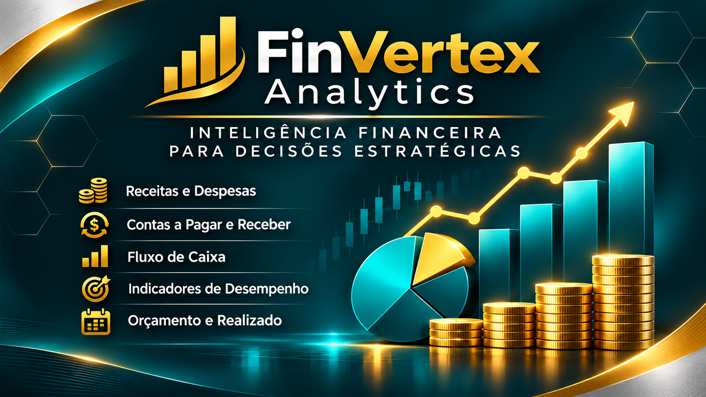

<div align="center">

# FinVERTEX Analytics

### Inteligência Financeira · Business Intelligence · Data Analytics

Projeto de Business Intelligence desenvolvido por **Renato Leone**.


**Transformando dados financeiros em indicadores, análises e insights para apoiar decisões estratégicas.**

</div>

---

## Visão geral

O **FinVERTEX Analytics** é um projeto de Business Intelligence voltado à análise financeira. A solução integra preparação e validação de dados, processamento com Python, armazenamento em PostgreSQL, consultas SQL, modelagem analítica e dashboards interativos no Power BI.

O projeto contempla seis perspectivas da gestão financeira: visão executiva, fluxo de caixa, receitas e despesas, orçamento, custos e centros de custo, e folha de pagamento.

Também explora a aplicação de Inteligência Artificial no processo de Data Quality, com um agente desenvolvido em Python e integrado ao Google Gemini.

**Fluxo de trabalho:** Dados → Data Quality → ETL → PostgreSQL → SQL Analytics → Modelagem → DAX → Dashboards → Insights.

<p align="center">
  
</p>

## Objetivos de negócio

- Consolidar indicadores de desempenho financeiro.
- Acompanhar receitas, despesas e resultado financeiro.
- Analisar entradas, saídas e movimentações de caixa.
- Avaliar orçamento, realizado e desvios.
- Identificar a distribuição e a concentração dos custos.
- Acompanhar os custos relacionados à folha de pagamento.
- Aplicar validações de qualidade para aumentar a confiabilidade dos dados.
- Demonstrar o uso responsável de IA como apoio ao trabalho analítico.

## Dados e escopo

- **Origem:** dados simulados para estudo e demonstração.
- **Domínio:** gestão financeira.
- **Período principal analisado:** 2024–2026.
- **Banco de dados:** PostgreSQL.
- **Processamento e validação:** Python e SQL.
- **Visualização:** Power BI Desktop.

Entre as estruturas utilizadas estão dimensões de calendário, funcionário, cliente, fornecedor, centro de custo e plano de contas, além de fatos de lançamentos financeiros, fluxo de caixa e orçamento.

## Tecnologias

| Tecnologia | Aplicação no projeto |
|---|---|
| Python e Pandas | Processamento, transformação e validação de dados |
| Google Gemini 2.5 Flash / Google AI Studio | Apoio inteligente ao processo de Data Quality |
| PostgreSQL | Armazenamento e organização dos dados |
| SQL | Consultas, validações e análises financeiras |
| Power Query (M) | Preparação e transformação no Power BI |
| DAX | Medidas e indicadores financeiros |
| Power BI Desktop | Dashboards e exploração analítica |

## Etapas do projeto

1. **Data Profiling e Data Quality** — avaliação de estrutura, tipos, nulos, duplicidades, chaves, integridade referencial e consistência.
2. **ETL com Python** — leitura, padronização, tratamento e preparação das bases.
3. **Agente de IA para Data Quality** — apoio à análise de arquivos com Python e Gemini, mantendo a validação final sob responsabilidade do analista.
4. **PostgreSQL e SQL Analytics** — armazenamento, consultas e verificações dos dados.
5. **Modelagem dimensional** — integração de dimensões e tabelas fato para análise por período e perspectiva de negócio.
6. **Indicadores e DAX** — criação de medidas para desempenho financeiro, fluxo de caixa, orçamento, custos e folha.
7. **Dashboards e insights** — apresentação dos resultados em seis páginas analíticas.

## Dashboards

As seis páginas do relatório estão apresentadas abaixo. Cada imagem corresponde à página respectiva do Power BI.

### 01 — Visão Financeira Executiva

Visão consolidada de receitas, despesas, resultado financeiro, caixa e principais insights.

<p align="center">
  
</p>

### 02 — Fluxo de Caixa

Entradas, saídas, conciliação e evolução do fluxo líquido de caixa.

<p align="center">
  
</p>

### 03 — Receitas e Despesas

Composição das despesas e evolução do resultado financeiro.

<p align="center">
  
</p>

### 04 — Orçado vs. Realizado

Execução orçamentária, desvios e acompanhamento por centro de custo.

<p align="center">
  
</p>

### 05 — Custos e Centros de Custo

Distribuição, evolução e concentração dos custos.

<p align="center">
  
</p>

### 06 — Folha de Pagamento

Composição e evolução dos custos com remuneração, benefícios e encargos.

<p align="center">
  
</p>

## Indicadores e resultados observados

Na base simulada e conforme as regras de negócio implementadas no relatório, foram observados:

- **Receita realizada:** aproximadamente R$ 134,28 milhões.
- **Despesas realizadas:** aproximadamente R$ 60,21 milhões.
- **Resultado financeiro:** aproximadamente R$ 74,07 milhões.
- **Índice de despesas sobre receitas:** 44,84%, classificado como **Moderado** pela regra adotada no dashboard.
- **Saldo líquido das movimentações de caixa:** aproximadamente R$ 66,53 milhões, calculado como entradas menos saídas consideradas no fluxo.

Resultado financeiro e saldo líquido de caixa são indicadores distintos, calculados a partir de fatos e critérios diferentes. Não devem ser tratados como valores equivalentes. Os resultados representam exclusivamente a base simulada utilizada no projeto.

## Insights e documentação

A pasta [`08_Insights`](08_Insights/) reúne sete documentos de análise:

1. [Insight Executivo](08_Insights/01_Insight_Executivo.md)
2. [Insight de Fluxo de Caixa](08_Insights/02_Insight_Fluxo_de_Caixa.md)
3. [Insight de Receitas e Despesas](08_Insights/03_Insight_Receitas_e_Despesas.md)
4. [Insight de Orçado vs. Realizado](08_Insights/04_Insight_Orcado_vs_Realizado.md)
5. [Insight de Custos e Centros de Custo](08_Insights/05_Insight_Custos_Centros_de_Custo.md)
6. [Insight de Folha de Pagamento](08_Insights/06_Insight_Folha_de_Pagamento.md)
7. [Recomendações Estratégicas](08_Insights/07_Recomendacoes_Estrategicas.md)

A pasta [`07_Documentacao`](07_Documentacao/) contém os materiais técnicos e registros do desenvolvimento.

## Estrutura do repositório

```text
FinVERTEX_Analytics/
├── 01_Fonte_Dados/
├── 02_Data_Quality/
├── 03_ETL_Python/
├── 04_PostgreSQL/
├── 05_SQL_Analytics/
├── 06_PowerBI/
│   └── FinVERTEX_Analytics.pbix
├── 07_Documentacao/
├── 08_Insights/
├── 09_Portfolio/
│   ├── 00_FinVERTEX_Capa.png
│   └── imagens das seis páginas do dashboard
└── README.md
```

## Como reproduzir

1. Clone ou baixe este repositório.
2. Consulte `01_Fonte_Dados` para conhecer os arquivos de origem.
3. Explore `02_Data_Quality` e `03_ETL_Python` para acompanhar as validações e transformações.
4. Utilize `04_PostgreSQL` e `05_SQL_Analytics` para configurar o banco e executar as consultas documentadas.
5. Abra `06_PowerBI/FinVERTEX_Analytics.pbix` no Power BI Desktop.
6. Ajuste as conexões e os caminhos das fontes de dados ao seu ambiente e atualize o relatório.

A reprodução pode exigir configuração local do PostgreSQL e dos caminhos das fontes. Credenciais, senhas e chaves de API não devem ser publicadas no repositório.

## Conclusão

O FinVERTEX Analytics demonstra a integração de Data Quality, ETL, Python, IA aplicada, PostgreSQL, SQL, modelagem dimensional e Power BI em um cenário de análise financeira. O foco está em transformar dados organizados e validados em indicadores, análises e informações úteis à gestão.

## Autor

**Renato Leone**  
Data Analytics & Business Intelligence

### Competências demonstradas

Data Profiling · Data Quality · ETL com Python · IA aplicada à análise de dados · PostgreSQL · SQL · Modelagem Dimensional · Power Query · DAX · Business Intelligence · Visualização de Dados.

### Portfólio e contato profissional

- **GitHub:** [github.com/rrleone](https://github.com/rrleone)
- **Repositório:** [FinVERTEX Analytics](https://github.com/rrleone/FinVERTEX_Analytics)
- **Portfólio:** [Renato Leone — Data Analytics & BI](https://www.renatoleone.com.br)

---

<div align="center">

**FINVERTEX ANALYTICS**

Dados · Qualidade · Inteligência · Decisões

**RENATO LEONE | DATA ANALYTICS & BUSINESS INTELLIGENCE**

</div>
